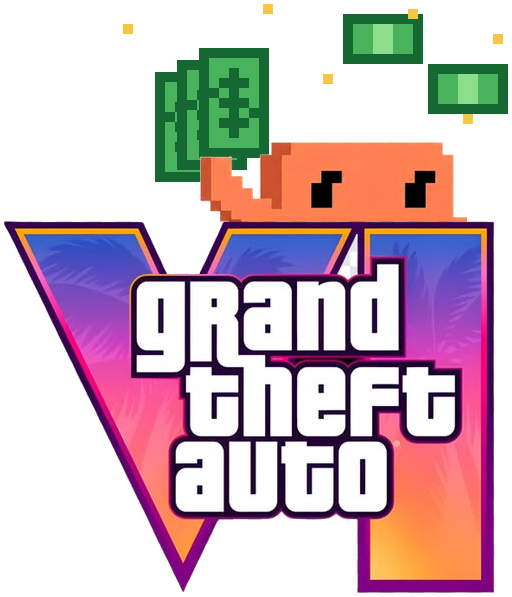

<div align="center">



<h1 align="center">claudeGTA6</h1>

<p align="center"><b>Rockstar made the game.<br>Claude Code makes you the money.</b></p>

<p align="center">GTA 6 is about to break the internet. Claude Code watches the biggest streams, catches the second chat explodes and hands you a ready-to-post vertical clip. Campaigns pay per 1,000 views. You just hit post.</p>

<p align="center">   </p>
<p align="center"></p>
<p align="center"><sub>Unofficial fan project. Not affiliated with Rockstar Games, Take-Two or Anthropic.</sub></p>
<p align="center"><a href="#install-in-claude-code-from-zero">Install from zero</a> · <a href="#first-run-paste-this-into-claude-code">Quick start</a> · <a href="#how-it-works">How it works</a> · <a href="#whats-inside">Skills</a> · <a href="#the-rules-that-make-clips-win">Clip rules</a></p>

</div>

> **Notice / provenance.** This repository redistributes the `gtavi-claudecode` Claude Code plugin, originally published by **[Bodila51](https://github.com/Bodila51)**. The original repository (`Bodila51/gtavi-claudecode`) is no longer available on GitHub. This mirror is published under the same MIT license the project originally shipped with (see [`LICENSE`](LICENSE)), with the original copyright notice preserved. Credit for the design of the skills and scripts goes to the original author.

---

## Vice Desk: Windows and Android apps (no Claude Code needed)

**[Download from Releases](https://github.com/Anurag123rk/claudeGTA6/releases/latest)**: `ViceDesk.exe` for Windows, a `.dmg` for macOS (Apple silicon), a single binary for Linux, or `ViceDesk-<version>.apk` for Android 10+. No Python, no login, no cloud backend.

Choose **Short clips** or **Long-form guides** at start; long-form sets up a Claude Code project (research → script → ElevenLabs voice → Apify footage → critic loop → YouTube). If YouTube says "confirm you're not a bot", sign in under Settings → YouTube sign-in.

The Android app runs the same pipeline on your phone (no captions there: the speech engine has no Android build). Share a YouTube/Twitch link to it, then share the finished clip straight to TikTok, Instagram or YouTube. It's built from [`android/`](android) with Chaquopy.

- **Paste a video, get clips.** The full pipeline runs in one click: download → transcribe → score moments → cut 1080x1920 clips → rule check.
- **Live monitor.** Step, stage and overall progress for every task, with **live download speed**, ETA, a speed graph and the full log.
- **Find videos.** Trending GTA 6 videos and live streams, with "Clip it" and "Record live" buttons on each row.
- **Live mode.** Records a Twitch/YouTube stream and cuts a clip every time chat explodes. Stop it any time from the GUI.
- **Library.** Every job, its candidate moments (cut any of them with a chosen layout) and in-app clip previews.

First run: if SmartScreen warns, click *More info → Run anyway* (the app is unsigned). ffmpeg is built in. On first launch you pick a speech model for captions (tiny/base/small/medium); it downloads once with a live speed readout, then everything runs offline. Output goes to `Documents\ViceDesk`.

Run from source on any OS: `pip install -r app/requirements-app.txt && python app/vicedesk.py` (add `--browser` to use your browser instead of a window). The `.exe` is built by [`.github/workflows/release.yml`](.github/workflows/release.yml) with PyInstaller (`app/vicedesk.spec`).

---

## Install in Claude Code, from zero

This section assumes you've never used Claude Code before.

### 1. Install Node.js

Claude Code needs Node.js 18 or newer.

- **Windows/macOS:** download the LTS installer from [nodejs.org](https://nodejs.org) and run it.
- **Verify** in a terminal:
  ```
  node --version
  ```
  You should see `v18.x` or higher.

### 2. Install Claude Code

```
npm install -g @anthropic-ai/claude-code
```

Verify:

```
claude --version
```

### 3. Log in

Run:

```
claude
```

The first run walks you through signing in with your Anthropic/Claude account (a browser window opens to approve the login). After that you'll land at the Claude Code prompt.

### 4. Add this repo as a plugin marketplace

Inside Claude Code, paste:

```
/plugin marketplace add Anurag123rk/claudeGTA6
```

This points Claude Code at this GitHub repo as a source of plugins.

### 5. Install the plugin

```
/plugin install gtavi-claudecode@claudeGTA6
```

Claude Code pulls down the skills and scripts and makes them available in every session from then on.

### 6. Confirm it installed

```
/plugin
```

should list `gtavi-claudecode`. You can also just ask Claude Code "what gtavi-claudecode skills do you have?" and it will list them.

That's the whole install — two slash commands. Everything below is how to use it once installed.

---

## First run: paste this into Claude Code

```
Use gtavi-claudecode. Set up my GTA 6 clip page, ask me your 4 questions in one message,
then do everything after one "yes": find live clipping campaigns, show today's trending
GTA 6 videos and live streams, find the best moments in the top one, cut my first 3 clips
with hooks, check them against the campaign rules, and tell me what to post where.
```

This triggers the `setup` skill first (installs the local tools the scripts need — ffmpeg, yt-dlp, faster-whisper — and creates a working folder on your machine for your page), then chains into the rest of the pipeline described below.

## How it works

The plugin is a set of **Claude Code skills** (instruction files Claude reads and follows) plus a handful of **Python scripts** that do the actual media work. Nothing runs in the background on its own — each skill fires when you ask for it, or when another skill chains into it — and Claude shows you what it found before anything gets posted.

The pipeline, end to end:

1. **Find something to clip.** `trend-radar` and `stream-finder` surface what GTA 6 content is popular or live right now. `campaign-finder` checks which paid clipping campaigns are open and what they currently pay per 1,000 views.
2. **Find the moment inside the video.** `moment-finder` (finished videos) or `live-mode` (an ongoing stream) scores footage for loudness spikes, hype words, YouTube's "most replayed" data and chat activity, then returns timestamps worth cutting.
3. **Cut the clip.** `clip-cutter` (or `twitch-reaction`/facecam layouts) uses `ffmpeg` to crop to a vertical 1080x1920 frame, `faster-whisper` to transcribe the audio, and burns in word-by-word captions plus a hook box, normalized to -14 LUFS loudness.
4. **Write the hook.** `hook-writer` proposes on-screen opening lines meant to stop the scroll in the first second.
5. **Check it's postable.** `rule-check` verifies length, format, hashtags, and that nothing in the clip breaks platform or campaign rules before you post.
6. **Optional: localize or map secrets.** `multilang` produces translated-caption versions (Spanish, Portuguese, German, Russian); `secrets-map` and `cheat-codes` turn discovered content into their own evergreen posts.
7. **Track what worked.** `learning-loop` logs each post and, after 24-72 hours, records real view/payout numbers so future picks improve.

You approve every post — the plugin never uploads anything by itself.

## Two ways to make money

**1. Paid clipping campaigns (fastest).** Streamers and brands pay clippers per 1,000 views on approved clips, with per-campaign rate, budget and rules. `campaign-finder` reads these live rather than guessing. You read the rules, clip only that creator, post, submit the link.

**2. Your own faceless GTA 6 page (bigger, slower).** The built-in playbook runs it: daily content mix, credit rules, caption templates, a launch-window "be first" plan, and a learning loop. The page grows on speed, useful tips and credited clips, then earns through campaigns and partnerships.

No income is promised. Your result depends on speed, picks and hooks — the scoreboard shows what actually works.

## The rules that make clips win

- Hook in the first second. Say why to keep watching.
- 7 to 30 seconds. Cut dead air at the start, end on the payoff.
- Big captions in the safe area. Most people watch muted.
- Make it yours: hook, tip, commentary. Never a plain re-upload. Credit the creator in your post.
- Post across platforms repeatedly during the launch window rather than once.
- Every repeated question in your comments becomes a HOW TO post.
- One test per day. No verdict before 24 hours, prefer the 72 h numbers.

## What's inside

| Skill | What you get |
|---|---|
| `setup` | Installs ffmpeg, yt-dlp and faster-whisper, asks 4 questions, builds your page folder |
| `campaign-finder` | Live campaigns: rate per 1K views, budget left, rules, link |
| `trend-radar` | GTA 6 videos from the last 24 h ranked by views per hour |
| `stream-finder` | Who is streaming GTA 6 right now, ranked by viewers |
| `moment-finder` | Best 15 to 40 s moments, scored by loudness spikes, hype words, YouTube "most replayed" and chat spikes |
| `live-mode` | Records a live stream and cuts a clip every time chat explodes |
| `twitch-reaction` | Reaction-style clips: streamer face on top, game below, title on the seam. Finds top GTA 6 Twitch streams with no account, reads chat, finds the webcam automatically |
| `clip-cutter` | 1080x1920 clip: word-by-word captions, hook box, -14 LUFS. Fill, blurred background or facecam layout |
| `hook-writer` | 3 hook options per clip |
| `rule-check` | Length, format, hashtags and banned content checked before posting |
| `multilang` | One clip in 5 languages: translated word-by-word captions and hook, optional stock-voice hook |
| `questions-to-posts` | Pulls repeated questions from GTA subreddits and your comments, turns answered ones into HOW TO posts |
| `secrets-map` | Builds a database of hidden spots, money, cars and collectibles from clips, with timestamp and credit |
| `cheat-codes` | Reported GTA 6 cheat codes with unlock tasks and sources, turned into a cheat carousel |
| `playbook` | Your full daily routine and launch-window plan |
| `learning-loop` | Scoreboard, one test per day, payouts from real numbers only |

Nothing is uploaded automatically. You approve every post.

## Hard rules

No leaks, no "play early" or "free download" posts, no piracy, no GTA Online money or AFK bots, no fake news, never pretends to be Rockstar. Every fact needs an official source.

## Run the scripts yourself

If you'd rather drive the Python directly instead of asking Claude Code to run a skill:

```
pip install -r requirements.txt
python scripts/trends.py --query "gta 6" --hours 24
python scripts/streams.py --query "gta 6"
python scripts/moments.py "https://www.youtube.com/watch?v=..." --top 8
python scripts/cut.py jobs/<id> --pick 2 --layout facecam --hook "Nobody noticed this"
python scripts/check.py jobs/<id>/edits/clip_2.mp4 --campaign campaigns.md
python scripts/live.py "https://www.youtube.com/watch?v=<live>" --minutes 60
```

Windows, macOS or Linux, Python 3.10+. An NVIDIA GPU makes transcription faster; on CPU a 12-minute video takes about 5 minutes.

## License

MIT — see [`LICENSE`](LICENSE). Original copyright retained from the upstream `gtavi-claudecode` project by Bodila51.
